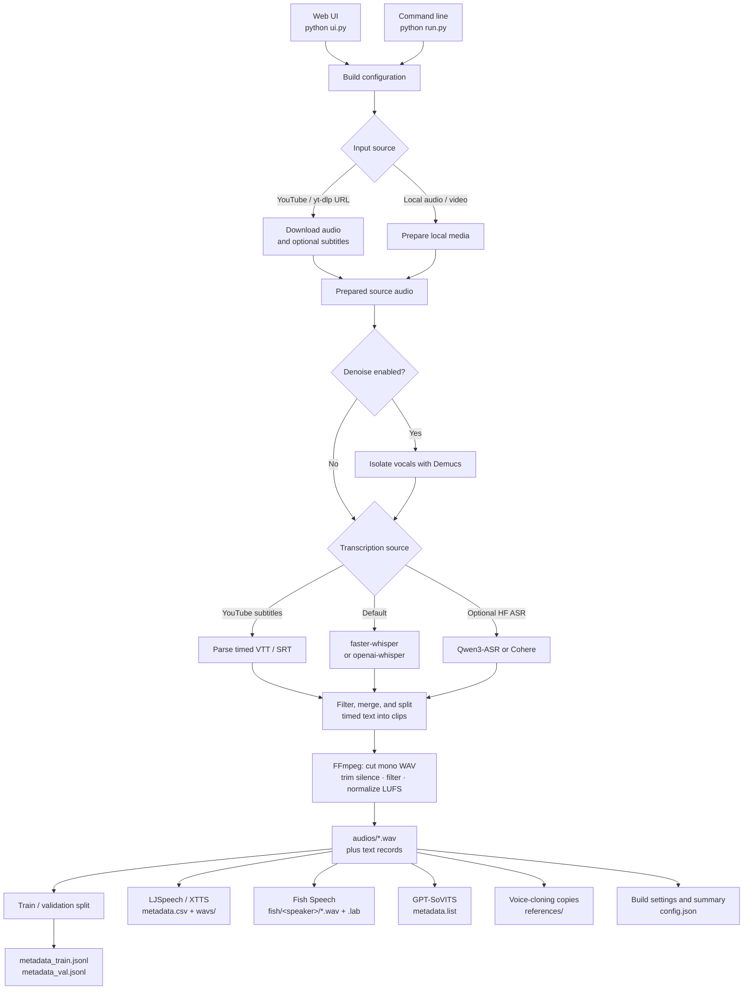

# Voice Dataset Builder

Turn YouTube URLs or local media into a TTS-ready voice dataset. Audio is
transcribed from subtitles or an ASR model, sliced into clean 3-12s mono WAV
clips, and written to `metadata_train.jsonl` plus `metadata_val.jsonl` when the
validation split is non-empty (along with optional model-specific formats).

The output always includes a canonical JSONL dataset and can also generate
ready-to-use layouts for XTTS-v2, Fish Speech, and GPT-SoVITS. The JSONL can be
adapted for F5-TTS, CosyVoice, Chatterbox, Qwen3-TTS, MOSS-TTS, and similar
models.

## Features

- Sources: YouTube/yt-dlp URLs and local audio/video files (tabs in the UI)
- Cleaning: leading/trailing silence trim, loudness normalization (target LUFS),
  optional Demucs vocal isolation
- Transcription: faster-whisper / openai-whisper plus optional downloaded
  Hugging Face ASR models, initial prompt (great for Vietnamese diacritics),
  confidence filter, optional YouTube subtitle reuse
- Output: JSONL (+ train/val split), LJSpeech CSV, Fish Speech `.lab`,
  GPT-SoVITS `.list`, or `universal` (all of them), auto `references/` clips
- UI: presets (Vietnamese / English Podcast / Audiobook / MOSS / XTTS), live
  phase progress bar, log stream, a 3-minute Test build, and a clip preview
  with inline audio players

## How it works



## Output layout

```
my_voice_dataset/
├── audios/
│   ├── speaker_01_0001.wav
│   └── ...
├── references/             # auto-selected clean 8-15s voice-cloning prompts
├── metadata_train.jsonl
├── metadata_val.jsonl      # present when the validation split is non-empty
├── metadata.csv            # LJSpeech: id|text|normalized_text
├── wavs/ -> audios/        # symlink for XTTS-v2's official ljspeech formatter
├── fish/
│   └── speaker_01/         # Fish Speech per-speaker layout (.wav + .lab pairs)
├── metadata.list           # GPT-SoVITS: absolute wav path|speaker|lang|text
└── config.json
```

> LJSpeech and Fish Speech are now fully compatible with the official recipes —
> no manual path editing needed. Wavs live once under `audios/` and are linked
> into `wavs/` (XTTS) and `fish/<speaker>/` (Fish Speech); the link falls back
> to a copy on filesystems that don't allow symlinks.

Reference clips are copies of a few generated records selected as clean speaker
examples for voice cloning. They live in a separate folder but are not held out
of the train/validation split.

JSONL line:

```json
{"audio_path": "audios/speaker_01_0001.wav", "text": "...", "speaker_id": "speaker_01", "language": "vi", "duration": 6.8}
```

## Install

FFmpeg is required on every operating system and must provide both `ffmpeg` and
`ffprobe`:

```bash
# macOS
brew install ffmpeg

# Debian / Ubuntu
sudo apt install ffmpeg
```

```powershell
# Windows PowerShell
winget install Gyan.FFmpeg
```

Restart the terminal after installation and verify it:

```bash
ffmpeg -version
ffprobe -version
```

Create the Python environment:

```bash
# macOS / Linux
python3.12 -m venv .venv
source .venv/bin/activate
pip install -r requirements.txt
```

```powershell
# Windows PowerShell
py -3.12 -m venv .venv
.venv\Scripts\Activate.ps1
pip install -r requirements.txt
```

To use the Settings screen for `Qwen/Qwen3-ASR-1.7B`,
`Qwen/Qwen3-ASR-0.6B`, or gated `CohereLabs/cohere-transcribe-03-2026`, install
the optional Hugging Face ASR dependencies first:

```bash
pip install -r requirements-asr.txt
```

Downloaded models are saved under `models/`.

With the venv active, run commands as `python run.py ...` / `python ui.py`.
Without activating, call `.venv/bin/python` on macOS/Linux or
`.venv\Scripts\python.exe` on Windows.

`faster-whisper` is the default transcription backend. CPU works out of the box
(`int8`); with an NVIDIA GPU it auto-uses CUDA + `float16`.

## Web UI

The easiest way to use it. Launch the local UI and fill in a form:

```bash
python ui.py
# or via the CLI:
python run.py --ui
```

This opens `http://127.0.0.1:8000/` in your browser. Paste one or more YouTube
URLs, set the speaker id / language / model, and click Build. Logs stream live
and a summary (clip count, total minutes, output path) shows when done.

Use the top-right Settings button to download optional ASR models. Cohere's
model requires approved Hugging Face access and a token entered in that screen.

Options: `python ui.py --host 0.0.0.0 --port 8080 --no-browser`.

The UI has no authentication. Keep the default `127.0.0.1` host unless you are
on a trusted private network; do not expose it directly to the internet.

The UI uses only the Python standard library, so no extra install is needed
beyond the pipeline's own dependencies (ffmpeg, yt-dlp, a Whisper backend).

## Usage

```bash
# Vietnamese with prompt + large model + universal output
python run.py "https://youtu.be/XXX" --speaker-id thanh_vn --language vi \
  --whisper-model large-v3 --initial-prompt "Xin chào, tiếng Việt có dấu." \
  --format universal

# Local files, denoise + tighter clips, quick 3-min test
python run.py --local /path/a.wav --local /path/b.mp4 --denoise \
  --min-clip 4 --max-clip 11 --limit-seconds 180

# Single video, auto-detect language
python run.py "https://www.youtube.com/watch?v=XXXX" \
  --speaker-id thanh_vn -o my_voice_dataset

# Force Vietnamese, larger model, 22.05kHz
python run.py "https://youtu.be/A" "https://youtu.be/B" \
  --language vi --whisper-model large-v3 --sample-rate 22050 \
  --speaker-id thanh_vn -o thanh_dataset

# Many URLs from a file
python run.py --urls-file urls.txt --speaker-id thanh_vn
```

Run `python run.py --help` for all options.

## Upload to Hugging Face

Before running `upload_to_hf.py`, install its optional dependencies:

```bash
pip install datasets
```

Edit these settings at the top of `upload_to_hf.py`:

```python
token = ""  # Leave blank after `hf auth login`, or paste a NEW write token.
root = Path(__file__).resolve().parent / "projects" / "my_voice_dataset"
repo_id = "username/dataset-name"
```

Then authenticate and upload:

```bash
hf auth login
python upload_to_hf.py
```

The uploader accepts either `audio_path` or `file_name`, preserves an optional
validation split, and uploads self-contained Parquet shards with a typed `Audio`
column so the Hugging Face viewer shows audio players. Never commit or share a
real access token. See Hugging Face's [audio dataset guide](https://huggingface.co/docs/datasets/audio_dataset).

## Key options

- `--speaker-id`        speaker label used in metadata and filenames
- `--language`          force a language code (e.g. `vi`, `en`); default auto
- `--sample-rate`       22050 or 24000 recommended (default 24000)
- `--min-clip/--max-clip` clip length window in seconds (default 3-12)
- `--whisper-model`     tiny/base/small/medium/large-v3 (default base)
- `--whisper-backend`   auto / faster-whisper / openai-whisper
- `--val-ratio`         validation split fraction (default 0.1)
- `--format jsonl`      write only canonical JSONL metadata
- `--keep-source-audio` keep full downloaded audio under `source_audio/`

## Notes

- Audio is loudness-normalized (EBU R128) per clip for consistent volume.
- GPT-SoVITS supports `zh`, `ja`, `en`, `ko`, and `yue` language tags; other
  languages, including Vietnamese, are mapped to `en` in `metadata.list`.
- Only download/transcribe content you have the rights to use.
- For best cloning results, prefer single-speaker, clean-audio sources and add
  a few hand-picked reference clips under `references/`.

## License

Licensed under the [MIT License](LICENSE).
