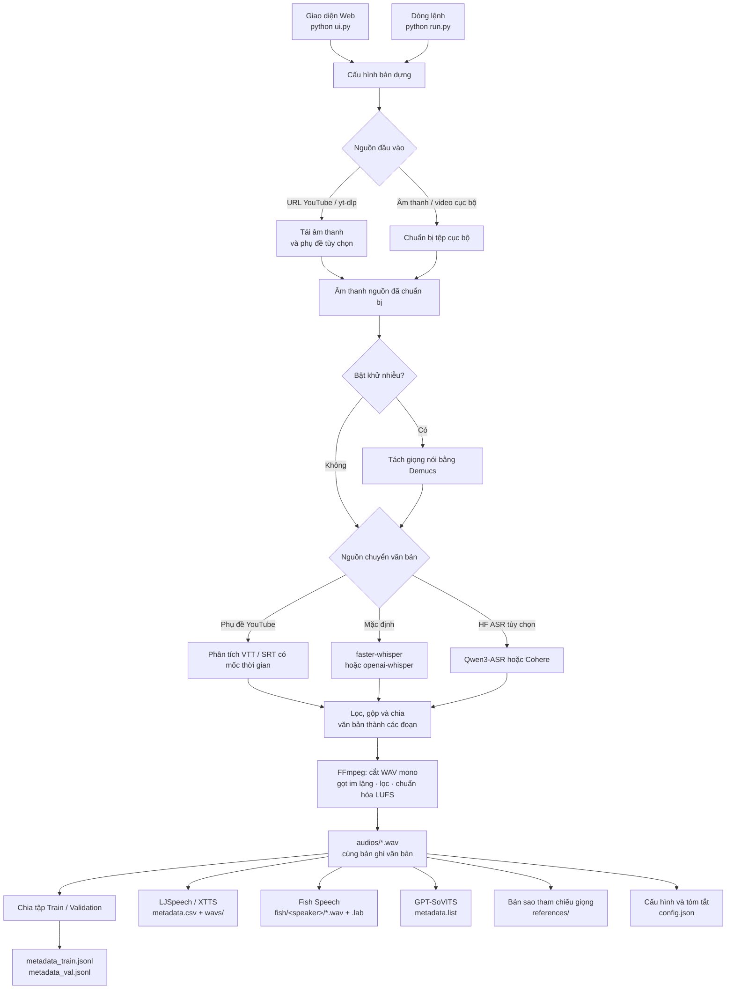

# Voice Dataset Builder

Biến các URL YouTube hoặc tệp đa phương tiện cục bộ thành bộ dữ liệu giọng nói sẵn sàng cho TTS (Text-to-Speech). Âm thanh được
chuyển văn bản từ phụ đề hoặc mô hình ASR, cắt thành các đoạn WAV đơn âm (mono) sạch từ 3-12 giây, và ghi vào `metadata_train.jsonl`; `metadata_val.jsonl` chỉ được tạo khi tập validation không rỗng (cùng với
các định dạng tùy chọn theo từng mô hình).

Đầu ra luôn bao gồm bộ dữ liệu JSONL chuẩn và có thể tạo các cấu trúc
dùng trực tiếp cho XTTS-v2, Fish Speech và GPT-SoVITS. JSONL có thể được
chuyển đổi cho F5-TTS, CosyVoice, Chatterbox, Qwen3-TTS, MOSS-TTS và các mô hình
tương tự.

## Các tính năng chính

- Nguồn: URL YouTube/yt-dlp và tệp âm thanh/video cục bộ (có các tab trong giao diện UI)
- Làm sạch: cắt bỏ khoảng lặng ở đầu/cuối, chuẩn hóa độ to âm thanh (mức LUFS mục tiêu),
  tùy chọn tách giọng nói bằng Demucs
- Chuyển văn bản (Transcription): faster-whisper / openai-whisper cùng tùy chọn tải về
  các mô hình ASR từ Hugging Face, câu nhắc khởi tạo (rất tốt cho dấu tiếng Việt),
  lọc theo độ tin cậy, tùy chọn sử dụng lại phụ đề YouTube
- Đầu ra: JSONL (+ chia tập train/val), LJSpeech CSV, Fish Speech `.lab`,
  GPT-SoVITS `.list`, hoặc `universal` (tất cả các định dạng trên), tự động tạo các đoạn âm thanh tham chiếu `references/`
- Giao diện UI: các cấu hình sẵn có (Vietnamese / English Podcast / Audiobook / MOSS / XTTS), thanh
  tiến trình trực tiếp, luồng log (nhật ký), bản dựng thử nghiệm 3 phút, và trình xem trước đoạn âm thanh
  với trình phát âm thanh tích hợp

## Cách thức hoạt động



## Cấu trúc thư mục đầu ra

```
my_voice_dataset/
├── audios/
│   ├── speaker_01_0001.wav
│   └── ...
├── references/             # tự động chọn các đoạn giọng nói tham chiếu sạch dài 8-15s để cloning
├── metadata_train.jsonl
├── metadata_val.jsonl      # chỉ có khi tập validation không rỗng
├── metadata.csv            # LJSpeech: id|text|normalized_text
├── wavs/ -> audios/        # symlink (liên kết tượng trưng) dùng cho bộ định dạng ljspeech chính thức của XTTS-v2
├── fish/
│   └── speaker_01/         # Cấu trúc thư mục cho từng người nói của Fish Speech (cặp .wav + .lab)
├── metadata.list           # GPT-SoVITS: đường dẫn wav tuyệt đối|người nói|ngôn ngữ|văn bản
└── config.json
```

> LJSpeech và Fish Speech hiện tương thích hoàn toàn với các quy trình chính thức —
> không cần chỉnh sửa đường dẫn thủ công. Các tệp Wav nằm một lần dưới thư mục `audios/` và được liên kết
> vào `wavs/` (XTTS) và `fish/<speaker>/` (Fish Speech); liên kết này sẽ trở thành
> một bản sao trên các hệ thống tệp không cho phép tạo liên kết tượng trưng (symlinks).

Các đoạn tham chiếu (Reference clips) là bản sao của một số mẫu đã tạo,
được chọn làm ví dụ giọng nói sạch cho voice cloning. Chúng nằm trong thư
mục riêng nhưng không bị loại khỏi tập train/validation.

Dòng JSONL:

```json
{"audio_path": "audios/speaker_01_0001.wav", "text": "...", "speaker_id": "speaker_01", "language": "vi", "duration": 6.8}
```

## Cài đặt

FFmpeg là bắt buộc trên mọi hệ điều hành và phải có sẵn cả `ffmpeg` và
`ffprobe`:

```bash
# macOS
brew install ffmpeg

# Debian / Ubuntu
sudo apt install ffmpeg
```

```powershell
# Windows PowerShell
winget install Gyan.FFmpeg
```

Khởi động lại terminal sau khi cài đặt và kiểm tra:

```bash
ffmpeg -version
ffprobe -version
```

Tạo môi trường Python:

```bash
# macOS / Linux
python3.12 -m venv .venv
source .venv/bin/activate
pip install -r requirements.txt
```

```powershell
# Windows PowerShell
py -3.12 -m venv .venv
.venv\Scripts\Activate.ps1
pip install -r requirements.txt
```

Để sử dụng màn hình Settings (Cài đặt) cho các mô hình `Qwen/Qwen3-ASR-1.7B`,
`Qwen/Qwen3-ASR-0.6B`, hoặc mô hình giới hạn quyền
`CohereLabs/cohere-transcribe-03-2026`, hãy cài các gói phụ thuộc Hugging Face ASR
tùy chọn trước:

```bash
pip install -r requirements-asr.txt
```

Các mô hình tải xuống được lưu trong thư mục `models/`.

Sau khi kích hoạt venv, hãy chạy lệnh dưới dạng `python run.py ...` / `python ui.py`.
Nếu không kích hoạt môi trường, hãy dùng `.venv/bin/python` trên macOS/Linux
hoặc `.venv\Scripts\python.exe` trên Windows.

`faster-whisper` là công cụ chuyển văn bản mặc định. CPU có thể chạy ngay không cần cấu hình thêm
(`int8`); nếu có GPU NVIDIA, hệ thống sẽ tự động dùng CUDA + `float16`.

## Giao diện Web (Web UI)

Cách dễ nhất để sử dụng. Chạy giao diện cục bộ và điền vào biểu mẫu:

```bash
python ui.py
# hoặc qua dòng lệnh CLI:
python run.py --ui
```

Lệnh này sẽ mở `http://127.0.0.1:8000/` trên trình duyệt của bạn. Dán một hoặc nhiều URL
YouTube, đặt ID người nói (speaker id) / ngôn ngữ / mô hình, và nhấn Build (Xây dựng). Nhật ký (logs) sẽ hiển thị trực tiếp
và bản tóm tắt (số đoạn cắt, tổng số phút, đường dẫn đầu ra) sẽ xuất hiện khi hoàn thành.

Sử dụng nút Settings (Cài đặt) ở góc trên bên phải để tải xuống các mô hình ASR tùy chọn. Mô hình của Cohere
yêu cầu quyền truy cập đã được phê duyệt trên Hugging Face và một token (mã thông báo) được nhập vào màn hình đó.

Tùy chọn: `python ui.py --host 0.0.0.0 --port 8080 --no-browser`.

Giao diện không có xác thực. Hãy giữ host mặc định `127.0.0.1` trừ khi bạn
đang dùng mạng riêng đáng tin cậy; không mở trực tiếp ra Internet.

Giao diện UI chỉ sử dụng thư viện tiêu chuẩn của Python, nên không cần cài đặt thêm gì
ngoài các gói phụ thuộc riêng của quy trình xử lý (ffmpeg, yt-dlp, các công cụ Whisper).

## Sử dụng

```bash
# Tiếng Việt với câu nhắc + mô hình large + đầu ra universal
python run.py "https://youtu.be/XXX" --speaker-id thanh_vn --language vi \
  --whisper-model large-v3 --initial-prompt "Xin chào, tiếng Việt có dấu." \
  --format universal

# Tệp cục bộ, giảm nhiễu (denoise) + cắt đoạn ngắn hơn, bản kiểm thử nhanh 3 phút
python run.py --local /path/a.wav --local /path/b.mp4 --denoise \
  --min-clip 4 --max-clip 11 --limit-seconds 180

# Một video duy nhất, tự động phát hiện ngôn ngữ
python run.py "https://www.youtube.com/watch?v=XXXX" \
  --speaker-id thanh_vn -o my_voice_dataset

# Ép dùng tiếng Việt, mô hình lớn hơn, tần số lấy mẫu 22.05kHz
python run.py "https://youtu.be/A" "https://youtu.be/B" \
  --language vi --whisper-model large-v3 --sample-rate 22050 \
  --speaker-id thanh_vn -o thanh_dataset

# Nhiều URL từ một tệp
python run.py --urls-file urls.txt --speaker-id thanh_vn
```

Chạy `python run.py --help` để xem tất cả các tùy chọn.

## Tải lên Hugging Face

Trước khi chạy `upload_to_hf.py`, hãy cài các gói phụ thuộc tùy chọn:

```bash
pip install datasets
```

Sửa các thiết lập sau ở phần đầu tệp `upload_to_hf.py`:

```python
token = ""  # Để trống sau khi chạy `hf auth login`, hoặc dán MỘT token ghi MỚI.
root = Path(__file__).resolve().parent / "projects" / "my_voice_dataset"
repo_id = "username/dataset-name"
```

Sau đó xác thực và tải lên:

```bash
hf auth login
python upload_to_hf.py
```

Công cụ uploader chấp nhận cả `audio_path` hoặc `file_name`, bảo tồn tập xác thực (validation split) tùy chọn,
và tải lên các tệp Parquet tự chứa (self-contained) với cột `Audio` được định dạng chuẩn
để trình xem trước của Hugging Face có thể hiển thị trình phát âm thanh. Không bao giờ commit (lưu trữ phiên bản) hoặc chia sẻ
token truy cập thực của bạn. Xem [hướng dẫn về bộ dữ liệu âm thanh](https://huggingface.co/docs/datasets/audio_dataset) của Hugging Face.

## Các tùy chọn chính

- `--speaker-id`        nhãn người nói dùng trong siêu dữ liệu và tên tệp
- `--language`          ép mã ngôn ngữ (ví dụ: `vi`, `en`); mặc định là tự động
- `--sample-rate`       khuyến nghị dùng 22050 hoặc 24000 (mặc định 24000)
- `--min-clip/--max-clip` khoảng thời gian độ dài của mỗi đoạn cắt tính bằng giây (mặc định 3-12)
- `--whisper-model`     tiny/base/small/medium/large-v3 (mặc định là base)
- `--whisper-backend`   auto / faster-whisper / openai-whisper
- `--val-ratio`         tỷ lệ tập xác thực (validation) (mặc định 0.1)
- `--format jsonl`      chỉ ghi siêu dữ liệu JSONL chuẩn
- `--keep-source-audio` giữ lại toàn bộ tệp âm thanh gốc đã tải xuống trong thư mục `source_audio/`

## Ghi chú

- Âm thanh được chuẩn hóa độ to (EBU R128) cho từng đoạn cắt để đảm bảo âm lượng đồng đều.
- GPT-SoVITS chỉ hỗ trợ các nhãn ngôn ngữ `zh`, `ja`, `en`, `ko` và `yue`; các
  ngôn ngữ khác, bao gồm tiếng Việt, được chuyển thành `en` trong `metadata.list`.
- Chỉ tải xuống/chuyển văn bản các nội dung mà bạn có quyền sử dụng.
- Để có kết quả cloning tốt nhất, ưu tiên các nguồn âm thanh sạch, đơn người nói và thêm
  vài đoạn cắt được chọn lọc thủ công vào mục `references/`.

## Giấy phép

Được cấp phép theo [Giấy phép MIT](LICENSE).
