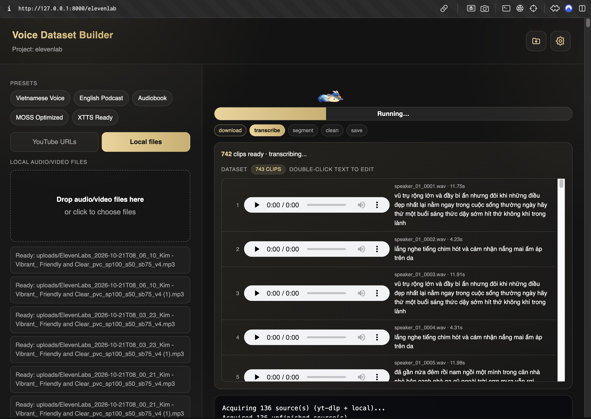

<div align="center">

# Voice Dataset Builder

**Your recordings. Clean clips. A dataset ready for the next step.**

Turn YouTube videos and local media into transcribed WAV clips for TTS workflows.
Build, listen, and refine — from a local web interface or the command line.

<p>
  
  
  
  <a href="LICENSE"></a>
</p>

[Demo](#demo) · [Features](#features) · [Quick start](#quick-start) · [CLI](#command-line) · [Output](#dataset-output)

[Tiếng Việt](README_vi.md)

</div>

## Demo



Upload media, follow transcription progress, and review playable clips as they
arrive. Double-click a transcript to make a correction.

## Features

| | What you can do |
| :--- | :--- |
| **Bring your sources** | Paste multiple YouTube / yt-dlp URLs, drag in local audio or video, or enter file paths. |
| **Choose transcription** | Use faster-whisper, openai-whisper, optional Qwen3-ASR or Cohere models, or reuse YouTube captions with ASR fallback. |
| **Clean the audio** | Trim edge silence, remove low-frequency rumble, normalize loudness, and optionally isolate vocals with Demucs. |
| **Shape the clips** | Adjust clip-length targets, merge gaps, sample rate, channels, and PCM bit depth. |
| **Review as you build** | Follow phase progress and live logs, play generated audio, and edit transcripts inline. |
| **Keep projects organized** | Create named projects, reopen saved inputs and clips, and reveal output folders in your file manager. |
| **Pick up later** | Stop a build, save completed clips as a partial dataset, and resume from matching checkpoints. |
| **Test a source** | Process the first three minutes of each input before committing to a full build. |
| **Export your way** | Write JSONL, LJSpeech/XTTS CSV, Fish Speech pairs, GPT-SoVITS lists, or all formats together. |
| **Prepare training data** | Generate seeded train/validation splits and reference clips; upload through the separate Hugging Face script. |

**Defaults:** 24 kHz · mono · 16-bit WAV · 3–12 second clip targets · −23 LUFS · 10% validation.

Each build uses one speaker label. Choose single-speaker sources; speaker
diarization and TTS model training are outside this app's workflow.

## Quick start

### 1. Install FFmpeg

Install both `ffmpeg` and `ffprobe` and make sure they are available on `PATH`.

| Platform | Command |
| :--- | :--- |
| macOS | `brew install ffmpeg` |
| Ubuntu / Debian | `sudo apt install ffmpeg` |
| Windows | `winget install Gyan.FFmpeg` |

### 2. Set up Python

Run from the repository root with Python 3.12:

```bash
python3.12 -m venv .venv
source .venv/bin/activate
python -m pip install -r requirements.txt
```

<details>
<summary>Windows PowerShell</summary>

```powershell
py -3.12 -m venv .venv
.venv\Scripts\Activate.ps1
python -m pip install -r requirements.txt
```

</details>

### 3. Launch and build

```bash
python ui.py
```

Open [localhost:8000](http://127.0.0.1:8000), create a project, add your sources,
and choose **Build dataset** or **Test (3 min)**.

The interface uses Python's standard library and needs no frontend build.
Use `python ui.py --port 8080 --no-browser` to change the port and skip opening
a browser automatically. `python run.py --ui` launches the same interface.

## Make it yours

### Start with a preset

| Preset | Model | Clip target | Export |
| :--- | :--- | :--- | :--- |
| **Vietnamese Voice** | `large-v3`, Vietnamese prompt | 3–12 s | Universal |
| **English Podcast** | `small`, English | 4–12 s | Universal |
| **Audiobook** | `medium`, auto language | 5–14 s | JSONL |
| **MOSS Optimized** | `large-v3`, 24 kHz | 3–20 s | JSONL |
| **XTTS Ready** | `medium`, 22.05 kHz | 3–11 s | LJSpeech + JSONL |

Presets update selected fields. You can fine-tune the remaining settings before
building.

### Adjust transcription and cleaning

- **Whisper:** choose a model, force a language or allow detection, add an
  initial prompt, and optionally filter segments by average log probability.
- **Audio:** adjust silence threshold, high-pass frequency, target LUFS, and
  optional two-pass loudness normalization in the UI.
- **Format:** select 16 / 22.05 / 24 / 48 kHz, mono or stereo, and 16 / 24 /
  32-bit PCM in the UI.
- **Review:** double-click text to edit; Enter, focus loss, or three seconds of
  inactivity saves. Escape restores the text from when editing began. Edits
  update the existing metadata formats and resume records.

<details>
<summary>Optional models and vocal isolation</summary>

```bash
# Alternative Whisper backend
python -m pip install openai-whisper

# Demucs vocal isolation
python -m pip install demucs

# Hugging Face ASR runtimes
python -m pip install -r requirements-asr.txt
```

Open **Settings** to download and select:

| Model | Download directory |
| :--- | :--- |
| `Qwen/Qwen3-ASR-1.7B` | `models/Qwen3-ASR-1.7B/` |
| `Qwen/Qwen3-ASR-0.6B` | `models/Qwen3-ASR-0.6B/` |
| `CohereLabs/cohere-transcribe-03-2026` | `models/Cohere-Transcribe-03-2026/` |

The Cohere download requires a Hugging Face token with model access. Registered
Qwen/Cohere models transcribe short windows in AI mode; the initial prompt and
Whisper confidence filter do not apply to these paths.

Inference runs locally after model downloads. CPU is supported; CUDA requires
a compatible runtime. Automatic device detection checks PyTorch's CUDA
availability and otherwise uses CPU.

Demucs offers `htdemucs` and `htdemucs_ft` in the UI. Use one source per build
with Demucs: the current stem lookup can select a previous source's vocals in
a multi-source build.

</details>

## Command line

```bash
# Build from a local recording
python run.py --local /path/recording.wav \
  --speaker-id narrator --language en -o projects/narrator

# Vietnamese video with a decoding prompt
python run.py "https://youtu.be/VIDEO_ID" \
  --language vi --whisper-model large-v3 \
  --initial-prompt "Xin chào, đây là bản ghi âm tiếng Việt có dấu." \
  -o projects/vietnamese

# A three-minute test with JSONL output
python run.py --local /path/recording.mp4 \
  --limit-seconds 180 --format jsonl -o projects/test

# Batch inputs from line-separated lists
python run.py --urls-file urls.txt --local-file paths.txt \
  --format ljspeech --format fish -o projects/batch
```

Use `--local` repeatedly for multiple files. Add `--prefer-subtitles` to prefer
downloaded captions, or `--denoise` to enable optional vocal isolation.
`--format` is repeatable; canonical JSONL is always included.

```bash
python run.py --help
```

<details>
<summary>Use the Python API</summary>

```python
from pathlib import Path
from voice_dataset_builder import BuildConfig, build_dataset

summary = build_dataset(BuildConfig(
    local_sources=["/path/recording.wav"],
    output_dir=Path("projects/my_voice"),
    speaker_id="my_voice",
    language="vi",
    highpass_hz=80,
    loudnorm_two_pass=True,
    output_formats=["universal"],
))

print(summary["clips"], summary["total_audio_min"])
```

`build_dataset` accepts `log`, `progress`, `preview`, and `should_cancel`
callbacks. `BuildConfig` also exposes reference selection, silence thresholds,
Demucs model selection, and settings without dedicated CLI flags.

</details>

## Dataset output

```text
projects/my_voice/
├── audios/                 # Generated PCM WAV clips
├── references/             # Selected voice reference copies
├── metadata_train.jsonl    # Canonical training records
├── metadata_val.jsonl      # Present when validation is non-empty
├── metadata.csv            # LJSpeech: id|text|normalized_text
├── wavs/                   # Audio links or copies for LJSpeech/XTTS
├── fish/<speaker>/         # Paired .wav + .lab files
├── metadata.list           # GPT-SoVITS: path|speaker|language|text
├── config.json             # Build settings and summary
└── build_inputs.json       # Saved UI form values
```

Additional layouts depend on the selected format. The default **Universal**
option writes every format. `--keep-source-audio` also retains acquired sources
under `source_audio/`.

One JSONL record:

```json
{"audio_path":"audios/speaker_01_0001.wav","text":"Xin chào.","speaker_id":"speaker_01","language":"vi","duration":6.8}
```

JSONL uses relative paths and a seeded split. CSV, Fish, and GPT-SoVITS exports
contain all records. References are copies of up to six selected clips and
remain in the train/validation data. LJSpeech duplicates the transcript into
both text columns; it does not perform separate text normalization.

<details>
<summary>Upload a private dataset to Hugging Face</summary>

```bash
python -m pip install datasets huggingface_hub
hf auth login
```

Set `root` and `repo_id` in [upload_to_hf.py](upload_to_hf.py), leave `token`
empty to use your login, then run:

```bash
python upload_to_hf.py
```

The script checks audio paths, preserves an optional validation split, casts
the audio column to `datasets.Audio`, and uploads a private dataset.

</details>

## Before a full build

- **Use a fresh project for a new dataset.** A completed rebuild replaces
  generated metadata and removes stale clips and export layouts; it does not
  append to the previous dataset.
- **Keep resume inputs consistent.** Checkpoints need matching sources and
  processing settings. Stop is checked between operations, so an active
  download or inference may finish first. UI test runs use a different time
  limit from full builds; keep them in separate projects.
- **Treat clip lengths as targets.** Long timestamped segments are preserved
  for text/audio alignment, and silence trimming can shorten clips. The
  three-minute test limits generated coverage, not necessarily downloads or
  full-source Whisper transcription.
- **Confirm important transcript edits.** Reload a project before editing
  after switching from another job, and reopen it to confirm saved changes.
  The current UI can retain a previous job ID and does not surface save errors.
  Use the default pipe delimiter for CSV editing in the UI.
- **Check your training recipe.** GPT-SoVITS paths are absolute; unsupported
  language tags, including Vietnamese, map to `en`. Other TTS recipes may need
  an adapter. Preserve audio link targets when moving a dataset.
- **Keep the UI local.** The server has no authentication. Use the default
  `127.0.0.1` host and avoid simultaneous builds into the same project.

## Development

Run the existing logic checks without downloading models:

```bash
python tests/test_logic.py
```

The code lives in `voice_dataset_builder/`: `pipeline.py` orchestrates builds,
`transcribe.py` handles ASR and captions, `audio.py` handles cleaning, and
`metadata.py` writes exports. `webui.py` and `webui_page.py` provide the local
interface.

---

<div align="center">

Built for preparing voice datasets. Licensed under [MIT](LICENSE).

</div>
